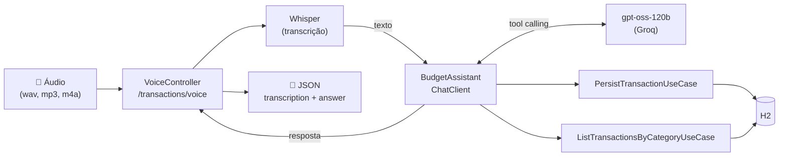
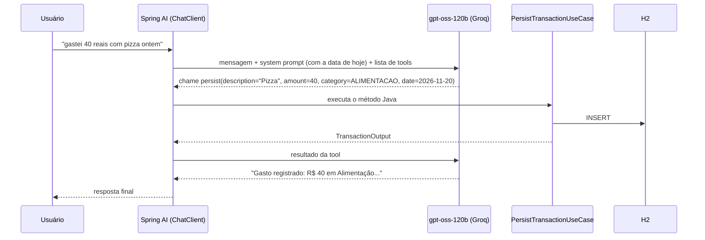
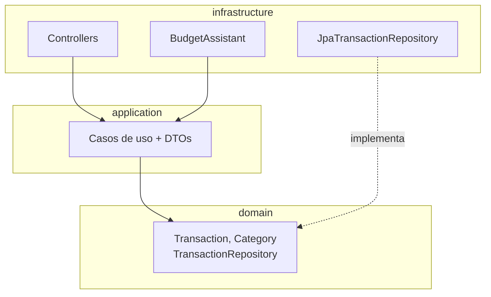
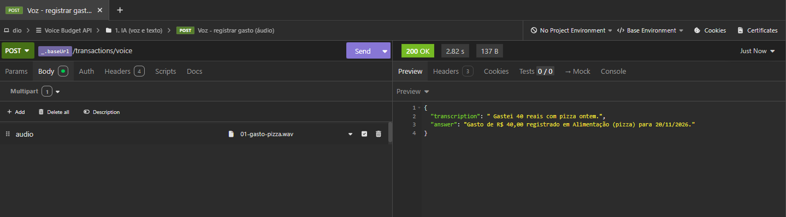
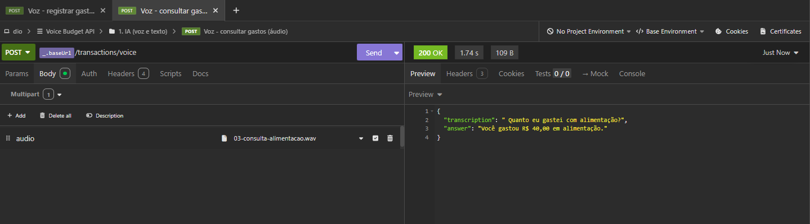
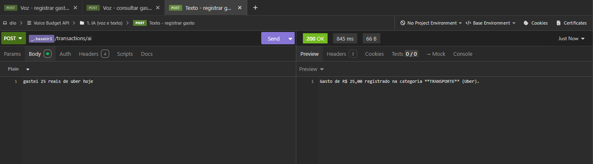
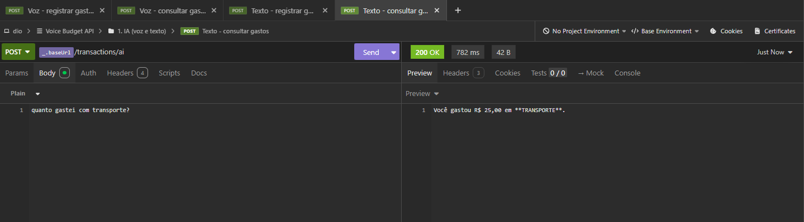
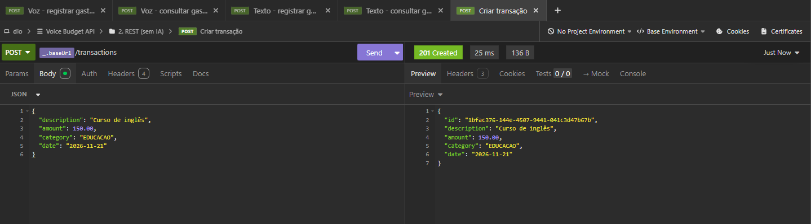
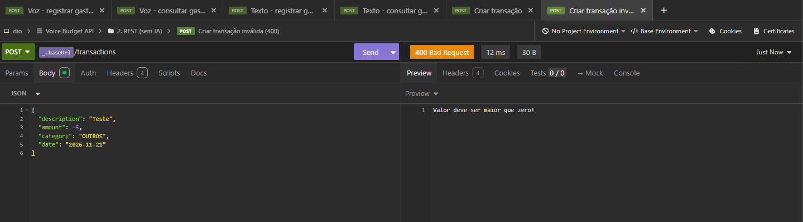
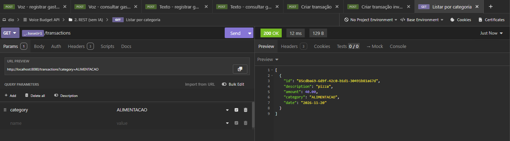

# 🎙️ Voice Budget API

**Uma API de orçamento pessoal que você controla pela voz.**

Você manda um áudio dizendo *"gastei 40 reais com pizza ontem"*, e a API transcreve a fala, entende o que você quis dizer, salva o gasto na categoria certa e responde. Também dá para perguntar *"quanto eu gastei com alimentação?"* e receber o total.


> Projeto final do bootcamp **CI&T – Java AI Copilot** da [DIO](https://www.dio.me/): *"Desenvolvendo sua API Inteligente com Reconhecimento de Fala e Spring Boot"*.

---

## 📑 Sumário

- [O que a API faz](#-o-que-a-api-faz)
- [Como funciona por dentro](#-como-funciona-por-dentro)
- [Arquitetura](#-arquitetura)
- [Decisões que tomei](#-decisões-que-tomei)
- [Um problema real que resolvi](#-um-problema-real-que-resolvi)
- [Como rodar](#-como-rodar)
- [Testando](#-testando)
- [Endpoints](#-endpoints)
- [Próximos passos](#-próximos-passos)

---

## ✨ O que a API faz

| Você diz (ou escreve) | A API faz |
|---|---|
| "Gastei 40 reais com pizza ontem" | Salva R$ 40,00 em **ALIMENTACAO** com a data de ontem |
| "Paguei 120 reais na conta de luz hoje" | Salva R$ 120,00 em **MORADIA** com a data de hoje |
| "Quanto eu gastei com alimentação?" | Consulta o banco e responde o total da categoria |

Você não precisa dizer a categoria nem a data no formato certo: o modelo de IA deduz a categoria pelo contexto e converte "hoje" e "ontem" em datas reais, porque o prompt de sistema informa a data do dia a cada pedido.

Categorias disponíveis: `ALIMENTACAO`, `TRANSPORTE`, `MORADIA`, `LAZER`, `SAUDE`, `EDUCACAO`, `OUTROS`.

---

## 🧠 Como funciona por dentro



O ponto central é o **Tool Calling** do Spring AI. Os casos de uso são métodos Java comuns, só que anotados com `@Tool`. O Spring AI transforma esses métodos em "ferramentas" que o modelo de IA pode pedir para executar:



O modelo nunca acessa o banco diretamente. Ele só **pede** para chamar um método, e quem executa é o Java, passando por todas as validações do domínio.

---

## 🏛️ Arquitetura

Organizei o código em três camadas, inspirado em DDD / arquitetura hexagonal:

```
src/main/java/com/andynn/budget
├── domain/                         ← Java puro, sem nenhuma dependência de framework
│   ├── Transaction.java            (record com validação no construtor)
│   ├── TransactionId.java          (record que encapsula o UUID)
│   ├── Category.java               (enum)
│   └── TransactionRepository.java  (interface: o domínio diz O QUE precisa)
│
├── application/                    ← casos de uso: o que o sistema FAZ
│   ├── PersistTransactionUseCase.java          (@Tool registrar gasto)
│   ├── ListTransactionsByCategoryUseCase.java  (@Tool listar por categoria)
│   ├── PersistTransactionInput.java            (DTO de entrada)
│   └── TransactionOutput.java                  (DTO de saída)
│
└── infrastructure/                 ← detalhes técnicos: banco, HTTP, IA
    ├── TransactionEntity.java              (@Entity JPA + conversão de/para o domínio)
    ├── TransactionEntityRepository.java    (Spring Data JPA)
    ├── JpaTransactionRepository.java       (adaptador: implementa a interface do domínio)
    ├── TransactionController.java          (REST sem IA)
    ├── BudgetAssistant.java                (ChatClient + tools + system prompt)
    ├── AssistantController.java            (endpoint de texto)
    └── VoiceController.java                (endpoint de voz)
```



**A regra é: as dependências sempre apontam para dentro.** O `domain` não conhece ninguém. A `application` conhece só o `domain`. Para trocar o H2 por PostgreSQL, por exemplo, só a `infrastructure` muda.

Um detalhe de que gosto: **a IA e o REST usam exatamente o mesmo caso de uso.** O `POST /transactions` e a tool chamada pelo modelo passam pelo mesmo `PersistTransactionUseCase`, então as regras valem igual para os dois caminhos.

---

## 🧭 Decisões que tomei

**`BigDecimal` em vez de centavos (`long`)**
Valor monetário com `double` dá erro de arredondamento, e guardar em centavos obriga a converter em todo lugar, o que é fácil de errar. Com `BigDecimal`, o valor fica exato e legível no banco (`numeric(12,2)`).

**Domínio puro, sem Lombok**
O domínio usa `record`s do Java 21, que já geram construtor, getters, `equals` e `hashCode`. Assim o coração do sistema não depende de nenhuma biblioteca.

**Validação dentro do domínio**
O construtor compacto do `Transaction` recusa descrição vazia, valor menor ou igual a zero, categoria nula e data nula. Isso protege o sistema **inclusive da IA**: se o modelo mandar um valor inválido, a transação simplesmente não é criada. O `TransactionEntity.toDomain()` também passa por esse construtor, então nem dados vindos do banco escapam da validação.

**Entidade JPA separada do domínio**
O JPA exige construtor vazio e campos mutáveis, o que não combina com um `record` imutável. Por isso existe o `TransactionEntity`, com `fromDomain()` e `toDomain()`. O domínio fica limpo, e o JPA fica feliz.

**Categoria salva como texto**
`@Enumerated(EnumType.STRING)` grava `"ALIMENTACAO"` em vez de `0`. Se alguém reordenar o enum no futuro, os dados antigos não se embaralham.

**Groq como provedor de IA**
O Groq é gratuito e compatível com a API da OpenAI. Usei o `spring-ai-starter-model-openai` apontando a `base-url` para o Groq, sem nenhuma dependência extra.

| Uso | Modelo |
|---|---|
| Chat + Tool Calling | `openai/gpt-oss-120b` |
| Transcrição | `whisper-large-v3-turbo` |

**Resposta em texto, não em áudio**
O único modelo de voz (TTS) do Groq fala só inglês e tem limite diário baixo. Ler uma resposta em português com voz em inglês ficaria ruim, então o endpoint de voz devolve a **transcrição** e a **resposta** em JSON. Assim dá para conferir o que a IA entendeu.

---

## 🐛 Um problema real que resolvi

Na primeira vez que testei, o gasto era **salvo no banco** (o `INSERT` aparecia no log), mas a API respondia **erro 500**:

```
BadRequestException: 400: 'messages.2' : property 'reasoning_content' is unsupported
```

**O que estava acontecendo:** o `gpt-oss-120b` é um modelo que "raciocina" e devolve esse raciocínio junto com a resposta. No Tool Calling acontecem **duas** chamadas ao modelo: uma em que ele pede a tool, e outra em que recebe o resultado. Na segunda, o Spring AI reenviava o raciocínio num campo (`reasoning_content`) que o Groq não aceita de volta.

**A solução:** pedir ao Groq que não devolva o raciocínio, usando o parâmetro `include_reasoning: false`:

```java
this.chatClient = builder
        .defaultOptions(OpenAiChatOptions.builder().extraBody(Map.of("include_reasoning", false)))
        .defaultTools(persistUseCase, listByCategoryUseCase)
        .build();
```

**Por que no Java e não no `application.properties`?** Testei primeiro com `spring.ai.openai.chat.extra-body[include_reasoning]=false`, mas no `.properties` todo valor vira texto. O Groq recebia `"false"` (string) e respondia `'include_reasoning' : value must be a boolean`. No Java, o `false` é um booleano de verdade.

---

## 🚀 Como rodar

**Pré-requisitos:** Java 21 e uma chave gratuita do Groq ([console.groq.com/keys](https://console.groq.com/keys)).

**1. Configure a chave como variável de ambiente.** Ela nunca fica no código:

```powershell
# Windows
setx GROQ_API_KEY "sua-chave-aqui"
```
```bash
# Linux / macOS
export GROQ_API_KEY="sua-chave-aqui"
```

> No Windows, feche e abra o terminal (ou a IDE) depois do `setx` para a variável valer.

**2. Clone e rode:**

```bash
git clone https://github.com/andynnnfw/dio-cit-spring-ai-voice-budget.git
cd dio-cit-spring-ai-voice-budget
./mvnw spring-boot:run        # Windows: .\mvnw spring-boot:run
```

A API sobe em `http://localhost:8080`.

**3. (Opcional) Veja o banco:** o console do H2 fica em `http://localhost:8080/h2-console`, com JDBC URL `jdbc:h2:mem:budget`, usuário `sa` e senha vazia.

---

## 🧪 Testando

### Áudios de teste inclusos

Na pasta [`docs/audios`](docs/audios) há três áudios em português prontos para usar:

| Arquivo | O que diz |
|---|---|
| `01-gasto-pizza.wav` | "Gastei quarenta reais com pizza ontem." |
| `02-gasto-luz.wav` | "Paguei cento e vinte reais na conta de luz hoje." |
| `03-consulta-alimentacao.wav` | "Quanto eu gastei com alimentação?" |

Você também pode gravar a sua própria voz: o Whisper aceita `wav`, `mp3`, `m4a`, `ogg` e outros formatos.

### Coleção do Insomnia

Em [`docs/insomnia/voice-budget-collection.json`](docs/insomnia/voice-budget-collection.json) está a coleção com todos os pedidos prontos. No Insomnia: **Import → From File** e escolha o arquivo.

> Nos pedidos de voz, confira se o campo `audio` aponta para um dos arquivos de `docs/audios`. Se não apontar, clique no campo e escolha o arquivo de novo.

### Na prática

**🎤 Registrando um gasto por voz**



**🎤 Consultando gastos por voz**



**💬 Registrando um gasto por texto**



**💬 Consultando por texto**



**📝 REST sem IA: criando uma transação**



**🛡️ A validação do domínio barrando um valor negativo**



**📋 Listando por categoria**



### Pelo terminal (curl)

```bash
# Voz
curl -F "audio=@docs/audios/01-gasto-pizza.wav" http://localhost:8080/transactions/voice

# Texto
curl -X POST -H "Content-Type: text/plain" --data "gastei 25 reais de uber hoje" http://localhost:8080/transactions/ai

# Listar
curl "http://localhost:8080/transactions?category=ALIMENTACAO"
```

> No PowerShell, use `curl.exe` em vez de `curl`.

---

## 📡 Endpoints

| Método | Rota | Corpo | Descrição |
|---|---|---|---|
| `POST` | `/transactions/voice` | `multipart/form-data`, campo `audio` | Transcreve o áudio e conversa com a IA |
| `POST` | `/transactions/ai` | `text/plain` | Conversa com a IA por texto |
| `POST` | `/transactions` | `application/json` | Cria uma transação direto, sem IA |
| `GET` | `/transactions?category=X` | — | Lista as transações de uma categoria |

<details>
<summary><b>Exemplos de requisição e resposta</b></summary>

**`POST /transactions/voice`**
```json
{
  "transcription": "Gastei 40 reais com pizza ontem.",
  "answer": "Gasto de R$ 40,00 registrado em Alimentação (pizza) para 20/11/2026."
}
```

**`POST /transactions`**
```json
{
  "description": "Curso de inglês",
  "amount": 150.00,
  "category": "EDUCACAO",
  "date": "2026-11-21"
}
```
Resposta `201 Created`:
```json
{
  "id": "1bfac376-144e-4507-9441-041c3d47b67b",
  "description": "Curso de inglês",
  "amount": 150.00,
  "category": "EDUCACAO",
  "date": "2026-11-21"
}
```

**Valor inválido** → `400 Bad Request`
```
Valor deve ser maior que zero!
```
</details>

---

## 🔭 Próximos passos

- [ ] Resposta em áudio (TTS) quando houver um modelo em português disponível
- [ ] Tool de resumo: total gasto no mês, por categoria
- [ ] Conversão de moeda (ex.: "gastei 10 dólares") com OpenFeign
- [ ] Banco persistente (PostgreSQL) e testes automatizados dos casos de uso

---

<p align="center">
  Feito por <a href="https://github.com/andynnnfw">Anderson</a> durante o bootcamp CI&T – Java AI Copilot da DIO
</p>
